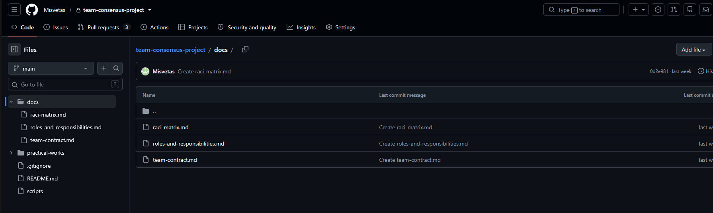
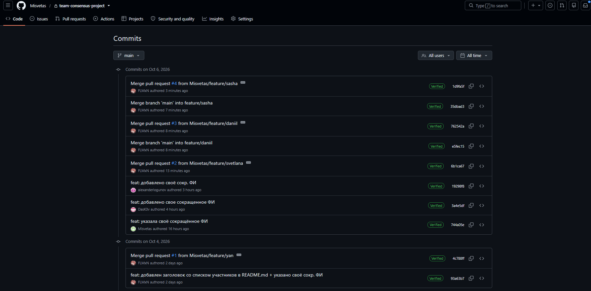
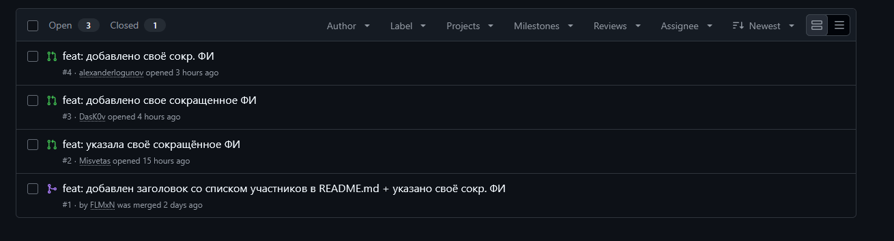

# Министерство образования РФ

**ФГБОУ ВО «РГРТУ»**

# Отчёт

**По самостоятельной работе №2**  
**«СР №2»**

**По дисциплине**  
**«Введение в профессиональную деятельность»**

**Отчёт составили:**  
Студенты групп 6413, 643, 6423:  
- Машталеров Ян  
- Логунов Александр  
- Милюхина Светлана  
- Косяков Даниил  
- Огундаре Болуватифе Дивайн  

**Рязань 2026**

---

## Название команды и состав

**Название команды:** «Консенсус»

**Состав команды:**

- Машталеров Ян (гр. 643) — Фуллстек-разработчик
- Логунов Александр (гр. 6423) — Тестировщик
- Милюхина Светлана (гр. 643) — Системный аналитик
- Косяков Даниил (гр. 6413) — Технический писатель
- Огундаре Болуватифе Дивайн (гр. 6423) — Бэкенд-разработчик

## 1. Регистрация участников на GitHub

Все участники команды зарегистрированы на платформе GitHub и имеют доступ к командному репозиторию. Логины участников приведены в таблице.

| Участник                      | Группа | Роль (СР1)              | Логин GitHub                          |
|-------------------------------|--------|-------------------------|---------------------------------------|
| Машталеров Ян                 | 643    | Фуллстек-разработчик    | https://github.com/FLMxN             |
| Логунов Александр             | 6423   | Тестировщик             | https://github.com/alexanderlogunov  |
| Милюхина Светлана             | 643    | Системный аналитик      | https://github.com/Misvetas          |
| Косяков Даниил                | 6413   | Технический писатель    | https://github.com/DasK0v            |
| Огундаре Болуватифе Дивайн    | 6423   | Бэкенд-разработчик      | https://github.com/Enivid345         |

## 2. Командный репозиторий

**Ссылка на репозиторий:** 

Репозиторий создала системный аналитик команды Милюхина Светлана. Она же организовала его структуру: разложила материалы по папкам и подготовила файлы, в которые участники вносят изменения по своим ролям.

### Структура репозитория

Документы команды размещены в папке `docs`:

- `docs/team-contract.md` — правила взаимодействия в команде;
- `docs/roles-and-responsibilities.md` — распределение ролей;
- `docs/raci-matrix.md`

Дерево папок и файлов репозитория показано на рисунке 1.

## 3. Распределение обязанностей по работе с репозиторием

Обязанности по работе с репозиторием распределены с опорой на роли, которые участники выбрали в самостоятельной работе №1.

| Участник                      | Роль (СР1)              | Обязанности в репозитории |
|-------------------------------|-------------------------|---------------------------|
| Машталеров Ян                 | Фуллстек-разработчик    | Проверка и оценка изменений в кодовой базе проекта; ревью Pull Request; решение о слиянии веток с основной веткой `main`. |
| Логунов Александр             | Тестировщик             | Проверка изменений перед слиянием: поиск ошибок и неточностей; фиксация замечаний в комментариях к Pull Request. |
| Милюхина Светлана             | Системный аналитик      | Создание командного репозитория; организация его структуры (папки и файлы); поддержание порядка в структуре при добавлении новых материалов. |
| Косяков Даниил                | Технический писатель    | Оформление документации в папке `docs`; единый стиль файлов Markdown; подготовка итогового отчёта. |
| Огундаре Болуватифе Дивайн    | Бэкенд-разработчик      | Внесение изменений в серверную часть кода в отдельной ветке; исправление замечаний, полученных на ревью. |

### Обоснование

1. **Системный аналитик (Милюхина Светлана):**  
   В СР1 к трудовым функциям системного аналитика отнесены проектирование структуры и оформление задач. Поэтому создание репозитория и организация его структуры закреплены за этой ролью: от структуры зависит, насколько удобно остальным участникам находить и изменять свои файлы.

2. **Фуллстек-разработчик (Машталеров Ян):**  
   По матрице RACI из СР1 фуллстек-разработчик выступает исполнителем (R) в разработке продукта и ответственным (A) за тестирование. Поэтому он проверяет и оценивает изменения в кодовой базе проекта: в основную ветку попадают только те изменения, которые прошли его ревью.

3. **Все участники:**  
   Независимо от роли каждый участник создаёт свою ветку на сайте GitHub, вносит изменения в файлы по своей роли, делает коммиты с понятными сообщениями и создаёт Pull Request.

## 4. Порядок работы с репозиторием

Команда работала с репозиторием через веб-интерфейс GitHub (сайт `github.com`), без установки Git на локальный компьютер. При таком способе клонировать репозиторий и отправлять изменения командой `push` не нужно: все изменения сразу сохраняются в удалённом репозитории.

Каждый участник команды выполнил одну и ту же последовательность действий.

1. **Создание своей ветки:**  
   На странице репозитория участник открывает список веток, вводит имя новой ветки и создаёт её от основной ветки `main`. Шаблон имени ветки: `feature/<имя_участника>` или `role/<название_роли>`.

2. **Внесение изменений:**  
   В своей ветке участник открывает нужный файл, нажимает кнопку редактирования (значок карандаша) и изменяет текст по своей роли. Новый файл создаётся через меню «Add file».

3. **Коммит:**  
   Изменения сохраняются кнопкой «Commit changes». В сообщении коммита коротко указывается суть изменения, например: `docs: дополнил описание своей роли`.

4. **Создание Pull Request:**  
   На вкладке «Pull requests» участник создаёт Pull Request для слияния своей ветки с основной веткой `main`.

5. **Ревью:**  
   Проверяющий открывает Pull Request, просматривает изменения на вкладке «Files changed», оставляет замечания и одобряет изменения.

6. **Слияние:**  
   После одобрения ветка сливается с основной кнопкой «Merge pull request».

## 5. История коммитов

Для каждого коммита GitHub хранит автора, дату и сообщение. По истории коммитов видно, кто из участников какие изменения внёс. История коммитов репозитория с указанием авторов показана на рисунке 2.

## 6. Pull Request и ревью

Изменения попадают в основную ветку `main` только через Pull Request. Каждый участник создаёт Pull Request из своей ветки. Изменения проверяет ведущий разработчик Машталеров Ян: просматривает изменённые файлы, оставляет замечания и после их исправления одобряет слияние. Pull Request самого ведущего разработчика проверяет другой участник команды.

Созданные Pull Request показаны на рисунке 3.

## 7. Вывод

В ходе самостоятельной работы 2 команда зарегистрировалась на GitHub, создала командный репозиторий и через веб-интерфейс GitHub отработала полный цикл работы с системой контроля версий: создание веток, коммиты, Pull Request, ревью и слияние.

Система контроля версий помогает организовать командную работу: участники работают параллельно в своих ветках и не мешают друг другу, а изменения попадают в основную ветку только после проверки. История коммитов и Pull Request фиксирует вклад каждого: видно, кто, когда и что изменил, и при необходимости можно вернуться к любой предыдущей версии.

