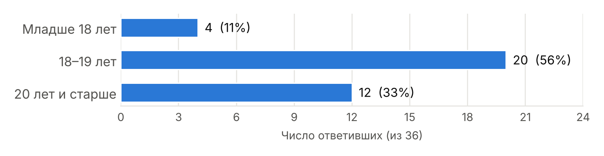
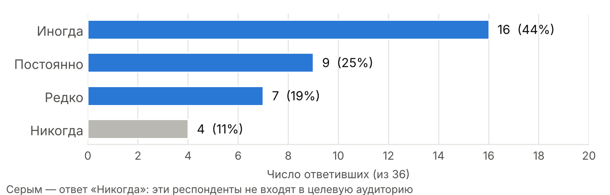
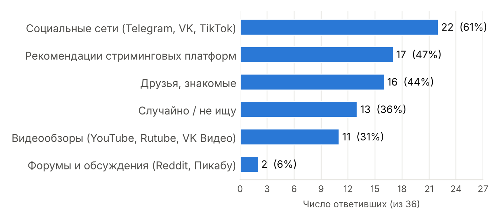
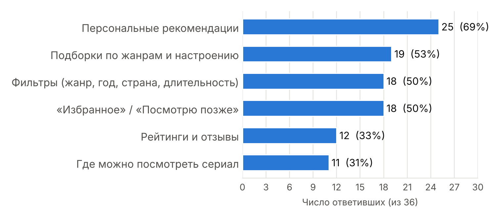
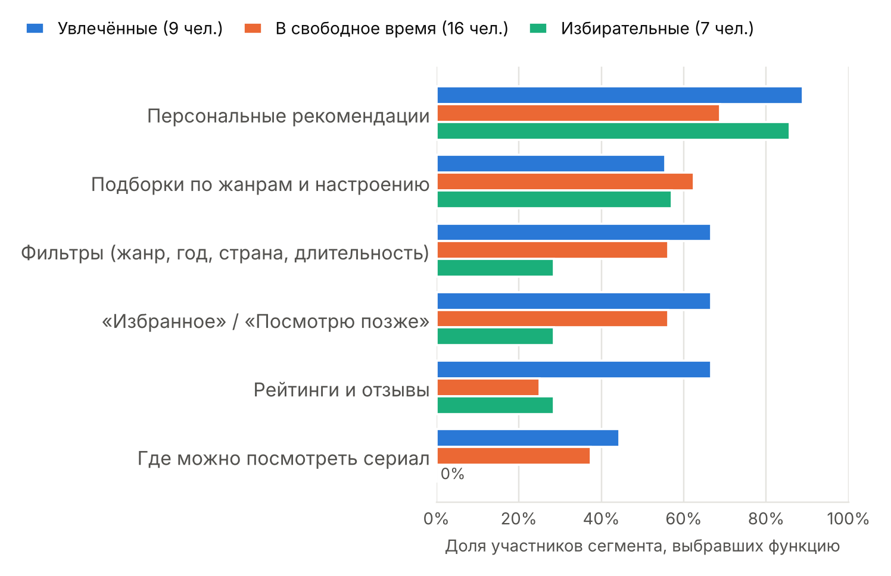
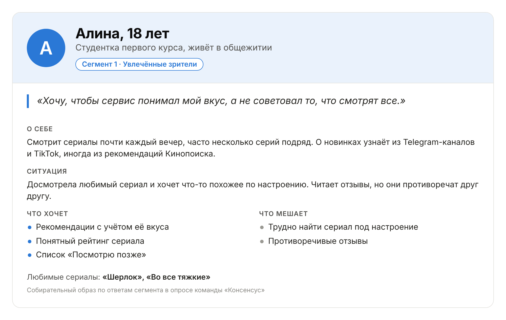
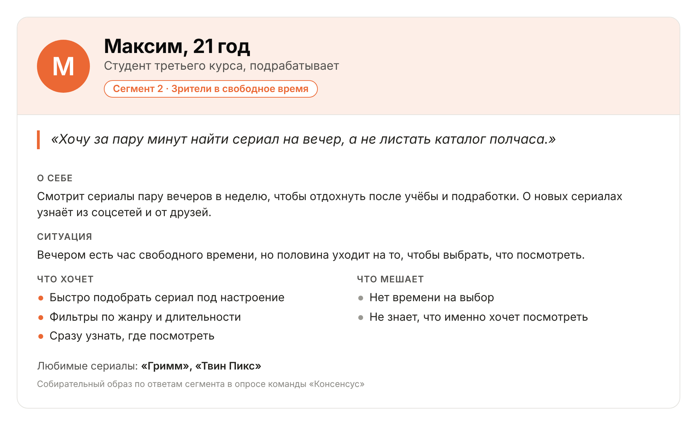
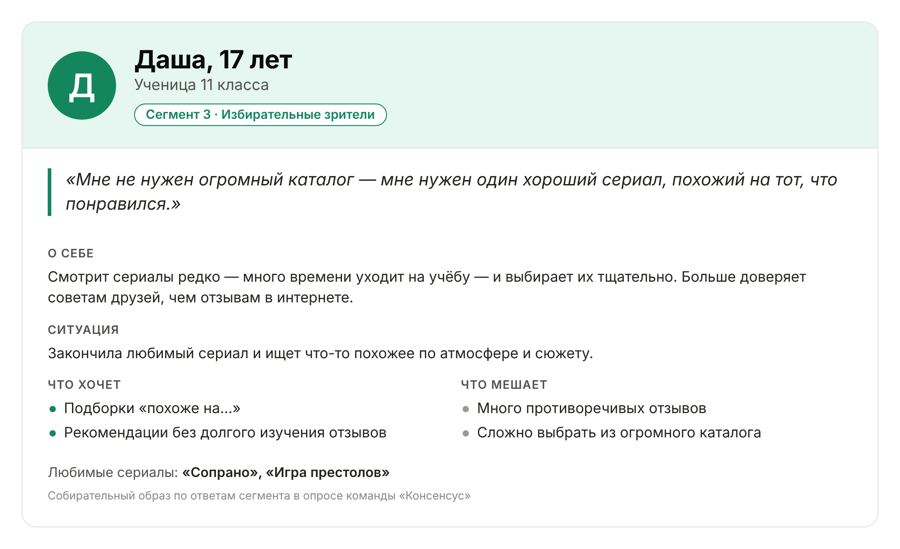

Министерство образования РФ · ФГБОУ ВО «РГРТУ»

# Отчёт по самостоятельной работе №3

**«Определение целевой аудитории»**

По дисциплине «Введение в профессиональную деятельность»

**Отчёт составили:** студенты групп 6413, 643, 6423 — Машталеров Ян, Логунов Александр, Милюхина Светлана, Косяков Даниил, Огундаре Болуватифе Дивайн.

Рязань 2026

---

## Название команды и состав

**Название команды:** «Консенсус»

**Состав команды:**

- Машталеров Ян (гр. 643) — Фуллстек-разработчик
- Логунов Александр (гр. 6423) — Тестировщик
- Милюхина Светлана (гр. 643) — Системный аналитик
- Косяков Даниил (гр. 6413) — Технический писатель
- Огундаре Болуватифе Дивайн (гр. 6423) — Бэкенд-разработчик

**Продукт команды:** сервис (сайт), который помогает выбрать сериал для просмотра.

## 1. Исследование аудитории

Чтобы понять, для кого создаётся продукт, команда провела онлайн-опрос в Google Формах. Опрос проходил с 17 по 19 октября 2026 года, на него ответили 36 человек в возрасте от 17 до 28 лет.

**Ссылка на опрос:** [https://docs.google.com/forms/d/e/1FAIpQLScjRtxWn7Vp_gVEwvrdjqNcwKzMkAOTCJSrYHwgfdqbOt2HBg/viewform](https://docs.google.com/forms/d/e/1FAIpQLScjRtxWn7Vp_gVEwvrdjqNcwKzMkAOTCJSrYHwgfdqbOt2HBg/viewform?usp=publish-editor)

Вопросы опроса:

1. Как часто вы сталкиваетесь с проблемой выбора сериала?
2. Где чаще всего вы находите сериалы для просмотра?
3. Что для вас самое трудное при выборе сериалов?
4. Какие функции были бы наиболее полезны для вас на сервисе?
5. Назовите ваш любимый сериал.
6. Какие рекомендации вы можете дать для улучшения сайта?

В вопросах 2–4 можно было выбрать несколько вариантов, поэтому сумма долей в них больше 100 %. Кроме ответов, в таблицу результатов внесён возраст каждого респондента.

## 2. Общие результаты опроса

*Рисунок 1 — Возраст респондентов*

Больше половины опрошенных (20 человек, 56 %) — в возрасте 18–19 лет. Ещё 12 человек (33 %) — 20 лет и старше, 4 человека (11 %) — младше 18 лет. Средний возраст — 19,4 года.

*Рисунок 2 — Как часто респонденты сталкиваются с проблемой выбора сериала*

Проблема выбора сериала актуальна для большинства: 25 человек из 36 (69 %) сталкиваются с ней постоянно или иногда. Только 4 человека (11 %) не сталкиваются с ней никогда.

*Рисунок 3 — Что труднее всего при выборе сериала*

Главная трудность — найти сериал под настроение (61 %). На втором месте — «не знаю, что именно посмотреть» (36 %), на третьем — противоречивые отзывы (28 %).

*Рисунок 4 — Где респонденты находят сериалы*

Чаще всего о сериалах узнают из социальных сетей (61 %), из рекомендаций стриминговых платформ (47 %) и от друзей (44 %). Форумами пользуются единицы (6 %).

*Рисунок 5 — Какие функции сервиса были бы полезны*

Самая востребованная функция — персональные рекомендации на основе вкусов (69 %). Следом идут подборки по жанрам и настроению (53 %), фильтры и возможность сохранить сериал в «Избранное» или «Посмотрю позже» (по 50 %).

## 3. Сегменты целевой аудитории

Продукт решает одну задачу — помогает выбрать сериал. Поэтому аудиторию команда разделила по ответу на первый вопрос: как часто человек сталкивается с проблемой выбора. Сравнение ответов внутри групп показало, что группы отличаются не только частотой, но и трудностями и нужными функциями (рисунок 6 и таблица 1). Так получилось три сегмента.

1. **«Увлечённые зрители»** — 9 человек (25 %), сталкиваются с проблемой выбора *постоянно*.

   Выбирают сериалы чаще всех, поэтому и требований к сервису у них больше: в среднем отмечали 3,9 функции из 6. Им важнее всего персональные рекомендации (8 из 9) и рейтинги (6 из 9 — заметно чаще, чем в других сегментах). Главные трудности — найти сериал под настроение (7 из 9) и противоречивые отзывы (5 из 9). Возраст — от 17 до 27 лет, большинство (5 из 9) — 18–19 лет.

2. **«Зрители в свободное время»** — 16 человек (44 %), сталкиваются с проблемой выбора *иногда*.

   Самый большой и самый взрослый сегмент: 7 из 16 — 20 лет и старше, младше 18 — никого. Только в нём отвечали «нет времени на выбор» (все 7 таких ответов). Им нужен быстрый выбор: подборки по жанрам и настроению (10 из 16), фильтры и «Посмотрю позже» (по 9 из 16).

3. **«Избирательные зрители»** — 7 человек (19 %), сталкиваются с проблемой выбора *редко*.

   О сериалах чаще узнают от друзей и из соцсетей (по 4 из 7), стриминговыми платформами пользуются реже других (2 из 7). Функций отмечали меньше всех (в среднем 2,3), но почти все хотят персональные рекомендации (6 из 7). Самый молодой сегмент: 6 из 7 младше 20 лет. В открытых ответах просили «подборки сериалов по схожей атмосфере, сюжету».

**Не входят в целевую аудиторию:** 4 человека (11 %), которые ответили «никогда». Трое из них не смотрят сериалы или дали несерьёзные ответы, ещё один не испытывает трудностей с выбором. Продукт им не нужен, поэтому дальше они не рассматриваются.

*Рисунок 6 — Нужные функции по сегментам (доля участников сегмента)*

*Таблица 1 — Нужные функции по сегментам*

| Функция | Увлечённые (9) | В свободное время (16) | Избирательные (7) |
|---|:-:|:-:|:-:|
| Персональные рекомендации | 8 (89 %) | 11 (69 %) | 6 (86 %) |
| Подборки по жанрам и настроению | 5 (56 %) | 10 (63 %) | 4 (57 %) |
| Фильтры (жанр, год, страна, длительность) | 6 (67 %) | 9 (56 %) | 2 (29 %) |
| «Избранное» / «Посмотрю позже» | 6 (67 %) | 9 (56 %) | 2 (29 %) |
| Рейтинги и отзывы | 6 (67 %) | 4 (25 %) | 2 (29 %) |
| Где можно посмотреть сериал | 4 (44 %) | 6 (38 %) | 0 (0 %) |

## 4. Характеристики сегментов

Доля, возраст, потребности и проблемы взяты из результатов опроса. Владение техникой и контекст использования — оценка команды: напрямую в опросе их не спрашивали.

| | Увлечённые зрители | Зрители в свободное время | Избирательные зрители |
|---|---|---|---|
| **Доля опрошенных** | 9 из 36 (25 %) | 16 из 36 (44 %) | 7 из 36 (19 %) |
| **Возраст** | 17–27 лет: младше 18 — 2, 18–19 — 5, 20 и старше — 2 | 18–28 лет: 18–19 — 9, 20 и старше — 7 | 17–20 лет: младше 18 — 2, 18–19 — 4, 20 и старше — 1 |
| **Владение техникой** | Уверенные пользователи интернета: соцсети (7 из 9), стриминговые платформы (5 из 9), видеообзоры (3 из 9) | Уверенные пользователи интернета: соцсети (11 из 16), стриминговые платформы (10 из 16); ценят простой и быстрый интерфейс | Пользуются интернетом, но больше доверяют живому общению: друзья (4 из 7), соцсети (4 из 7), стриминги реже (2 из 7) |
| **Контекст использования** | Смотрят часто; новый сериал ищут, когда досмотрели предыдущий; готовы потратить время, чтобы найти «своё» | Смотрят вечером или в выходные после учёбы и работы; на выбор есть несколько минут | Выбирают сериал редко — обычно когда закончили любимый и ищут похожий |
| **Потребности** | Персональные рекомендации (8 из 9); фильтры, рейтинги и «Избранное» (по 6 из 9) | Персональные рекомендации (11 из 16); подборки по жанрам и настроению (10 из 16); фильтры и «Посмотрю позже» (по 9 из 16) | Персональные рекомендации (6 из 7); подборки по жанрам и настроению (4 из 7); подборки «похоже на…» |
| **Проблемы** | Сложно найти сериал под настроение (7 из 9); много противоречивых отзывов (5 из 9) | Сложно найти сериал под настроение (12 из 16); нет времени на выбор (7 из 16); не знают, что посмотреть (7 из 16) | Много противоречивых отзывов (3 из 7); не знают, что посмотреть (3 из 7) |

## 5. Портреты пользователей

Для каждого сегмента составлен портрет — собирательный образ типичного пользователя. Имена и детали биографии придуманы, а цели и трудности взяты из ответов сегмента в опросе. Карточки портретов также лежат в репозитории в папке `practical-work-03/assets`.

### Алина, 18 лет — «Увлечённый зритель»

*Студентка первого курса, живёт в общежитии*

> «Хочу, чтобы сервис понимал мой вкус, а не советовал то, что смотрят все.»

**О себе.** Смотрит сериалы почти каждый вечер, часто несколько серий подряд. О новинках узнаёт из Telegram-каналов и TikTok, иногда из рекомендаций Кинопоиска.

**Ситуация.** Досмотрела любимый сериал и хочет что-то похожее по настроению. Читает отзывы, но они противоречат друг другу.

- **Что хочет:** рекомендации с учётом её вкуса; понятный рейтинг сериала; список «Посмотрю позже».
- **Что мешает:** трудно найти сериал под настроение; противоречивые отзывы.
- **Любимые сериалы:** «Шерлок», «Во все тяжкие».

### Максим, 21 год — «Зритель в свободное время»

*Студент третьего курса, подрабатывает*

> «Хочу за пару минут найти сериал на вечер, а не листать каталог полчаса.»

**О себе.** Смотрит сериалы пару вечеров в неделю, чтобы отдохнуть после учёбы и подработки. О новых сериалах узнаёт из соцсетей и от друзей.

**Ситуация.** Вечером есть час свободного времени, но половина уходит на то, чтобы выбрать, что посмотреть.

- **Что хочет:** быстро подобрать сериал под настроение; фильтры по жанру и длительности; сразу узнать, где посмотреть.
- **Что мешает:** нет времени на выбор; не знает, что именно хочет посмотреть.
- **Любимые сериалы:** «Гримм», «Твин Пикс».

### Даша, 17 лет — «Избирательный зритель»

*Ученица 11 класса*

> «Мне не нужен огромный каталог — мне нужен один хороший сериал, похожий на тот, что понравился.»

**О себе.** Смотрит сериалы редко — много времени уходит на учёбу — и выбирает их тщательно. Больше доверяет советам друзей, чем отзывам в интернете.

**Ситуация.** Закончила любимый сериал и ищет что-то похожее по атмосфере и сюжету.

- **Что хочет:** подборки «похоже на…»; рекомендации без долгого изучения отзывов.
- **Что мешает:** много противоречивых отзывов; сложно выбрать из огромного каталога.
- **Любимые сериалы:** «Сопрано», «Игра престолов».

Возраст героев выбран по типичному возрасту сегмента, а любимые сериалы взяты из ответов респондентов этого сегмента.

## 6. Единое видение целевой аудитории

Результаты опроса и предложенные сегменты команда обсудила в общем чате в Telegram. По правилам взаимодействия из СР1 принятое решение закреплено в чате, а итоговое описание аудитории размещено в репозитории в файле `practical-work-03/report.md`. Команда договорилась об одном описании целевой аудитории:

> Наш продукт — сервис, который помогает быстро выбрать сериал под настроение и вкус. Наша аудитория — молодые люди 17–28 лет (больше половины — 18–19 лет), которые регулярно смотрят сериалы, узнают о них из соцсетей, стриминговых платформ и от друзей и тратят на выбор слишком много времени. Главное, чего они ждут, — персональные рекомендации и подборки по настроению. Основной сегмент по численности — «Зрители в свободное время». Люди, которые не смотрят сериалы, не входят в целевую аудиторию.

Дальше это описание команда будет использовать в работе: системный аналитик — при постановке требований, разработчики — при выборе функций, тестировщик — при составлении сценариев проверки, технический писатель — в документации.

## 7. Вывод

В ходе самостоятельной работы №3 команда провела опрос, выделила три сегмента целевой аудитории, описала их характеристики и составила портреты пользователей. Особенности аудитории повлияют на будущий продукт так:

1. **Персональные рекомендации — основа продукта.** Это самая нужная функция в целом (69 %) и в каждом сегменте. Чтобы рекомендации учитывали вкус, пользователь должен оценивать просмотренные сериалы — функцию оценок отдельно просили и в открытых ответах.
2. **Подбор под настроение.** Это главная трудность (61 %), поэтому на главной странице нужен выбор настроения и подборки по жанрам и настроению, в том числе «похоже на…».
3. **Быстрый выбор.** Для самого большого сегмента важна скорость: нужны фильтры по жанру, году, стране и длительности и как можно меньше шагов до результата.
4. **Личный список.** Половина опрошенных хочет сохранять сериалы в «Избранное» или «Посмотрю позже» — значит, нужен личный кабинет.
5. **Доверие к оценкам.** Из-за противоречивых отзывов (28 %) на странице сериала лучше показывать понятный итоговый рейтинг и короткие отзывы.
6. **Где посмотреть.** 31 % хотят знать, где посмотреть сериал; в открытых ответах просили ссылки и бесплатный просмотр.
7. **Продвижение через соцсети.** Соцсети — главный источник сериалов (61 %), поэтому продвигать сервис стоит в Telegram, VK и TikTok и дать возможность делиться подборками.

Опрос небольшой (36 человек), поэтому выводы предварительные. В следующих опросах стоит спрашивать, с какого устройства человек выбирает сериал, и опросить больше людей старше 20 лет.
