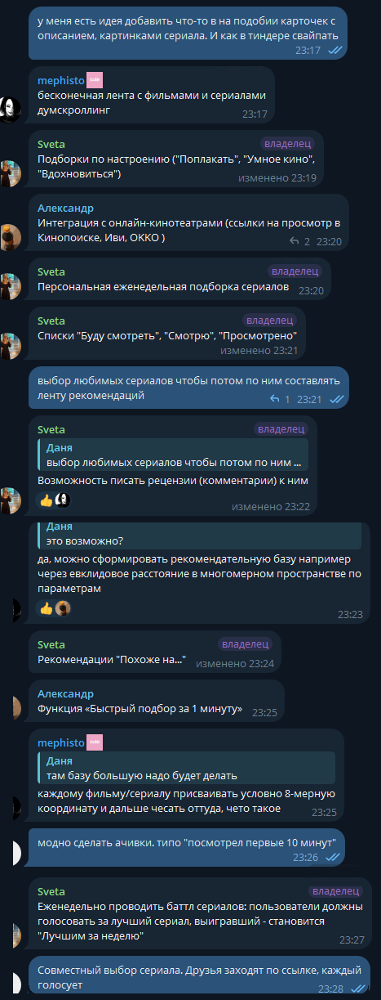
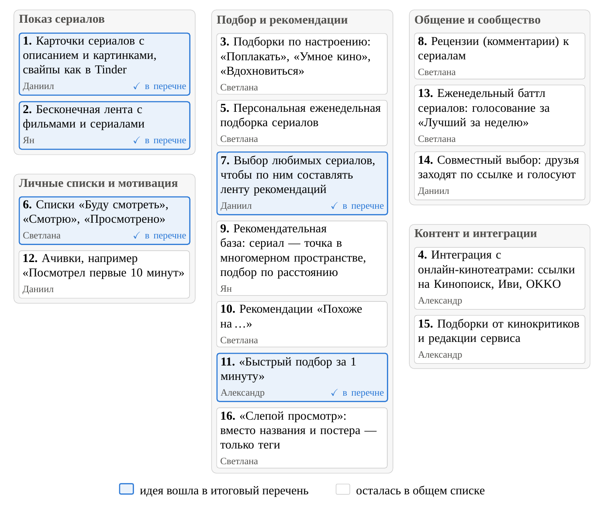

Министерство образования РФ · ФГБОУ ВО «РГРТУ»

# Отчёт по самостоятельной работе №4

**«Выявление функциональных требований методом мозгового штурма»**

По дисциплине «Введение в профессиональную деятельность»

**Отчёт составили:** студенты групп 6413, 643, 6423 — Машталеров Ян, Логунов Александр, Милюхина Светлана, Косяков Даниил, Огундаре Болуватифе Дивайн.

Рязань 2026

---

## Название команды и состав

**Название команды:** «Консенсус»

**Состав команды:**

- Машталеров Ян (гр. 643) — Фуллстек-разработчик
- Логунов Александр (гр. 6423) — Тестировщик
- Милюхина Светлана (гр. 643) — Системный аналитик
- Косяков Даниил (гр. 6413) — Технический писатель
- Огундаре Болуватифе Дивайн (гр. 6423) — Бэкенд-разработчик

**Продукт команды:** сервис (сайт), который помогает выбрать сериал для просмотра.

## 1. Описание проведения мозгового штурма

**Цель:** придумать функции будущего сайта, опираясь на потребности целевой аудитории, выявленные в самостоятельной работе №3.

**Формат:** онлайн, в общем чате команды в Telegram.

**Дата и длительность:** 3 ноября 2026 года, с 23:17 до 23:30 — около 13 минут (по времени сообщений в чате).

**Участники:**

| Участник | Роль (СР1) | Предложено идей |
|---|---|:-:|
| Машталеров Ян | Фуллстек-разработчик | 2 |
| Логунов Александр | Тестировщик | 3 |
| Милюхина Светлана | Системный аналитик | 7 |
| Косяков Даниил | Технический писатель | 4 |
| **Всего** | | **16** |

Огундаре Болуватифе в мозговом штурме не участвовал.

**Правила:**

1. Сначала предлагаем любые идеи, а потом выбираем подходящие. В чате это правило сформулировали так: «нужно нам сейчас придумывать любые идеи, а потом выбрать адекватные».
2. Идеи не критикуем и не отбрасываем: оценка откладывается до этапа отбора.
3. Записываем все идеи, даже спорные.

*Рисунок 1 — Идеи из чата штурма, 23:17–23:28 (организационные сообщения убраны)*

## 2. Полный список идей

Ниже перечислены все идеи в том порядке, в котором их предложили. Отбор на этом этапе не проводился.

| № | Время | Автор | Идея |
|:-:|:-:|---|---|
| 1 | 23:17 | Даниил | Карточки сериалов с описанием и картинками, которые можно свайпать, как в Tinder |
| 2 | 23:17 | Ян | Бесконечная лента с фильмами и сериалами («думскроллинг») |
| 3 | 23:19 | Светлана | Подборки по настроению: «Поплакать», «Умное кино», «Вдохновиться» |
| 4 | 23:20 | Александр | Интеграция с онлайн-кинотеатрами: ссылки на просмотр в Кинопоиске, Иви, OKKO |
| 5 | 23:20 | Светлана | Персональная еженедельная подборка сериалов |
| 6 | 23:21 | Светлана | Списки «Буду смотреть», «Смотрю», «Просмотрено» |
| 7 | 23:21 | Даниил | Выбор любимых сериалов, чтобы потом по ним составлять ленту рекомендаций |
| 8 | 23:22 | Светлана | Возможность писать рецензии (комментарии) к сериалам |
| 9 | 23:23 | Ян | Рекомендательная база: у каждого фильма и сериала есть набор параметров (условно 8-мерная координата), похожие ищутся по евклидову расстоянию в этом пространстве |
| 10 | 23:24 | Светлана | Рекомендации «Похоже на…» |
| 11 | 23:25 | Александр | Функция «Быстрый подбор за 1 минуту» |
| 12 | 23:26 | Даниил | Ачивки, например «Посмотрел первые 10 минут» |
| 13 | 23:27 | Светлана | Еженедельный баттл сериалов: пользователи голосуют за лучший сериал, победитель становится «Лучшим за неделю» |
| 14 | 23:28 | Даниил | Совместный выбор сериала: друзья заходят по ссылке, каждый голосует |
| 15 | 23:28 | Александр | Подборки от кинокритиков: тематические списки от авторитетных авторов и редакции сервиса |
| 16 | 23:30 | Светлана | «Слепой просмотр»: сайт рекомендует сериал, но скрывает название и постер и показывает только теги («драма, 90-е, хакеры, 1 сезон») |

## 3. Группировка и отбор идей

### Группировка

Идеи сгруппированы по назначению — какую задачу пользователя решает функция. Все идеи по группам показаны на рисунке 2.

| Группа | Идеи | Что объединяет |
|---|:-:|---|
| Показ сериалов | 1, 2 | Как сериалы выглядят на сайте и как пользователь их просматривает |
| Подбор и рекомендации | 3, 5, 7, 9, 10, 11, 16 | Как сайт помогает выбрать сериал |
| Личные списки и мотивация | 6, 12 | Что пользователь сохраняет и отмечает у себя |
| Общение и сообщество | 8, 13, 14 | Взаимодействие пользователей между собой |
| Контент и интеграции | 4, 15 | Материалы от редакции и связь с другими сервисами |

### Отбор

По итогам штурма команда отобрала пять идей. Обоснование опирается на результаты опроса целевой аудитории из СР3 (36 человек).

1. **Карточки со свайпами (идея 1).** Сайт показывает по одному сериалу с описанием и картинками, а пользователь сразу решает, интересен ли он. Это помогает тем, кто не знает, что посмотреть (36 % опрошенных), и тем, кому мешает слишком большой выбор (14 %).
2. **Бесконечная лента (идея 2).** Пользователю всегда есть что посмотреть, не нужно ничего искать. Вместе с идеей 7 лента становится персональной.
3. **Выбор любимых сериалов для ленты рекомендаций (идея 7).** Персональные рекомендации — самая нужная функция по опросу (69 %) и первая по важности в каждом сегменте аудитории.
4. **Списки «Буду смотреть», «Смотрю», «Просмотрено» (идея 6).** Сохранять сериалы в «Избранное» или «Посмотрю позже» хочет половина опрошенных (50 %).
5. **«Быстрый подбор за 1 минуту» (идея 11).** Рассчитан на самый большой сегмент — «Зрители в свободное время» (44 %): только в нём отвечали, что на выбор нет времени.

*Рисунок 2 — Схема: идеи штурма по группам; выделены идеи, вошедшие в итоговый перечень*

## 4. Итоговый перечень функциональных требований

| Код | Требование | Идея |
|:-:|---|:-:|
| ФТ-1 | Система должна показывать сериалы в виде карточек с описанием и картинками. | 1 |
| ФТ-2 | Пользователь должен иметь возможность свайпать карточку, как в Tinder: в одну сторону — сериал интересен, в другую — нет. | 1 |
| ФТ-3 | Система должна показывать бесконечную ленту фильмов и сериалов: при прокрутке подгружаются новые. | 2 |
| ФТ-4 | Пользователь должен иметь возможность отметить любимые сериалы, а система — составлять по ним ленту рекомендаций. | 7 |
| ФТ-5 | Пользователь должен иметь возможность добавлять сериалы в списки «Буду смотреть», «Смотрю» и «Просмотрено». | 6 |
| ФТ-6 | Система должна иметь функцию «Быстрый подбор», с которой пользователь подбирает сериал за 1 минуту. | 11 |

## 5. Вывод

В ходе самостоятельной работы №4 команда провела мозговой штурм, зафиксировала 16 идей, сгруппировала их и сформулировала 6 функциональных требований. Соотношение требований с потребностями аудитории из СР3 показано в таблице.

| Потребность аудитории (СР3) | Доля | Требования |
|---|:-:|:-:|
| Персональные рекомендации | 69 % | ФТ-3, ФТ-4 |
| «Избранное» / «Посмотрю позже» | 50 % | ФТ-5 |
| Не знаю, что посмотреть | 36 % | ФТ-1, ФТ-2, ФТ-3 |
| Нет времени на выбор | 19 % | ФТ-6, ФТ-1, ФТ-2 |
| Сложно найти сериал под настроение | 61 % | не покрыта |
| Подборки по жанрам и настроению | 53 % | не покрыта |
| Фильтры (жанр, год, страна, длительность) | 50 % | не покрыта |
| Рейтинги и отзывы | 33 % | не покрыта |
| Где можно посмотреть сериал | 31 % | не покрыта |
